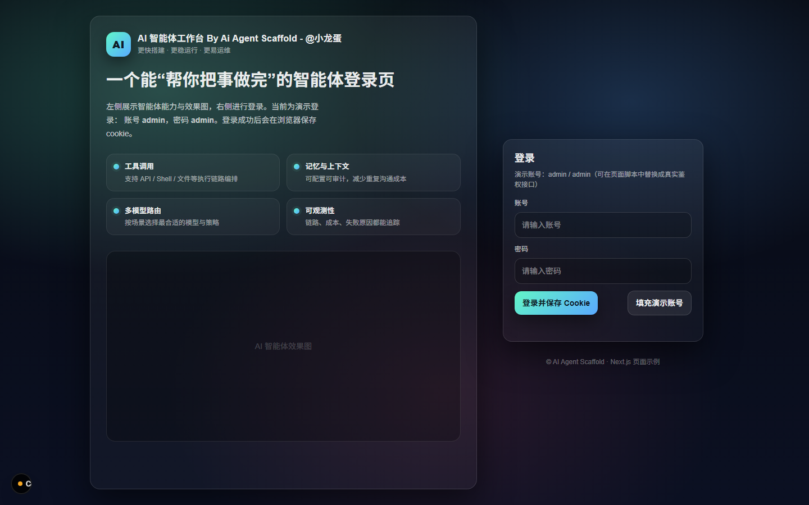
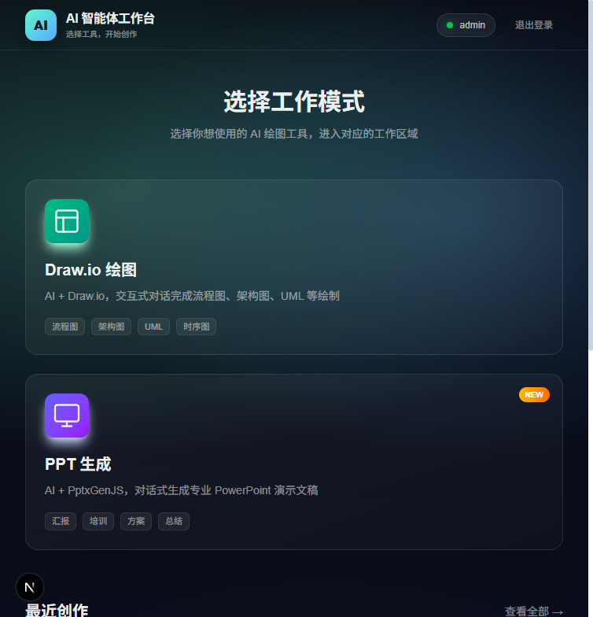
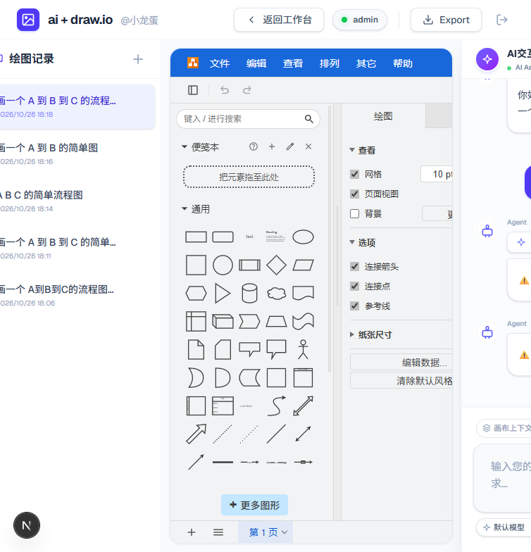
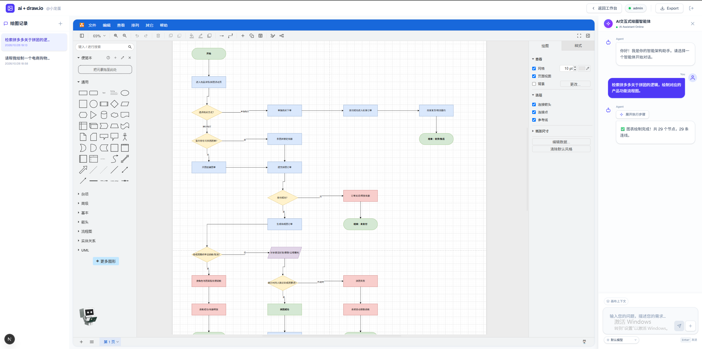
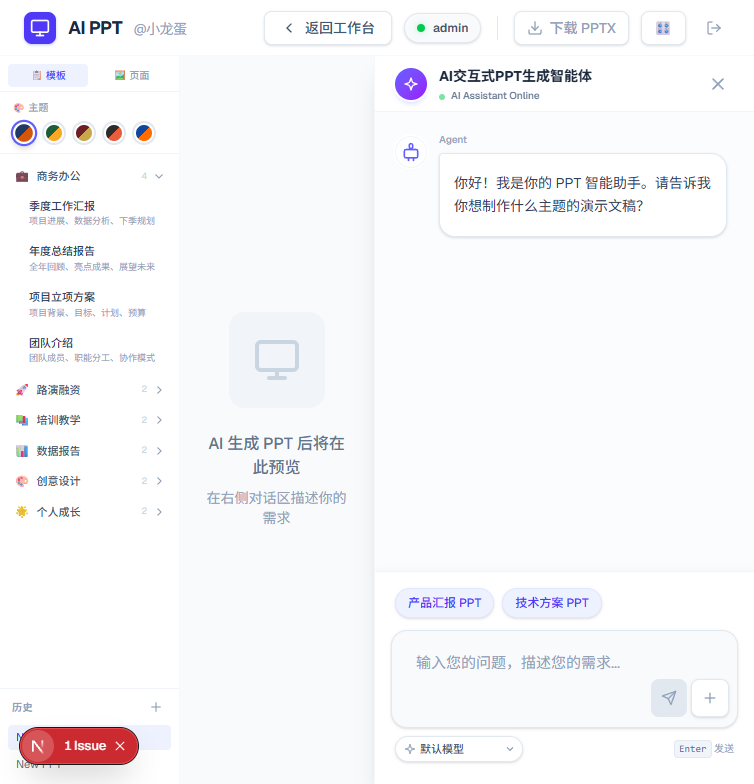

# AI Agent Draw.io

> 基于 AI Agent 脚手架扩展的场景应用 · 交互式绘图 + PPT 生成

## 项目简介

AI Agent Draw.io 是在 [ai-agent-scaffold-lite](./) 智能体脚手架基础上扩展的场景化应用,实现了两个高频办公场景:

- **AI + Draw.io 交互式绘图** — 通过自然语言对话,一句话生成流程图、UML、时序图、架构图,AI 直接读写 Draw.io 画布,支持多轮修改与审查修正
- **AI + PPT 生成** — 对话式生成专业 PowerPoint 演示文稿,前端基于 PptxGenJS 实时渲染,支持模板选择与在线预览、一键下载 PPTX

项目遵循 DDD 领域驱动设计,以脚手架的 **Armory 装配域 + 组合模式规则树** 为核心,把智能体执行所需的模型、工具、技能、编排全部抽象为可配置节点 —— "业务需要什么能力,就组装什么节点",两个场景均通过 YAML 编排配置驱动,未硬编码任何场景逻辑。

## 核心特性

- **多智能体协作绘图** — 需求分析(Analyst)→ 绘图执行(Drawer)→ 质量审查(Reviewer)三角色流水线,审查不通过自动反馈修正,循环优化最多 3 轮
- **流式渐进渲染** — Drawer 以逐行 JSON 流式输出画布元素(`drawio_node` / `drawio_edge` / `drawio_done`),前端边生成边绘制,无需等待完整 XML
- **绘图技能库** — 内置 UML 类图、时序图、系统架构图、流程图四类绘图技能(Skill),按需装配到绘图智能体
- **MCP 工具生态** — 集成百度搜索等 MCP Server 联网检索素材;支持 SSE / Stdio 多种 MCP 接入策略
- **灵活工作流** — 规则树支持串行、并行、循环流转,同一套节点可编排多种执行链路(主绘图链、循环优化链、并行方案链)
- **PPT 场景复用** — 复用脚手架装配与执行体系,仅新增场景编排配置与前端模板,即接入全新模态输出

## 界面展示

### 登录与工作台

左侧展示智能体能力(工具调用 / 记忆与上下文 / 多模型路由 / 可观测性),登录后进入工作台选择工作模式。





### AI + Draw.io 交互式绘图

完整内嵌 Draw.io 编辑器:左侧为绘图历史记录,中间为画布与形状库,右侧为 AI 对话面板 —— Agent 具备画布上下文感知能力,支持多轮对话式修改。




### AI + PPT 生成

内置多套行业模板(商务办公、路演融资、培训教学、数据报告等),对话确认大纲后逐页生成,右侧对话区实时反馈进度,生成完成即可预览与下载。



## 系统架构

后端延续脚手架的六边形分层,场景扩展聚焦在**编排配置**与**绘图域**:

```text
ai-agent-scaffold-draw-io
├── ai-agent-scaffold-draw-io-api            # 对外 API 定义
├── ai-agent-scaffold-draw-io-app            # 启动装配(agent-*.yml 编排配置)
├── ai-agent-scaffold-draw-io-case           # 用例编排层
├── ai-agent-scaffold-draw-io-domain         # 领域模型层
│   ├── agent
│   │   ├── armory                           # 装配域:模型/Agent/流程节点装配
│   │   │   ├── factory                      # 装配工厂(组合模式规则树构建)
│   │   │   ├── matter                       # 装配物料(MCP、技能、插件配置)
│   │   │   └── node                         # AiApi / ChatModel / Agent / Workflow 节点
│   │   └── chat                             # 会话执行域:Runner 驱动流程树执行
├── ai-agent-scaffold-draw-io-infrastructure # 基础设施(MySQL 会话持久化、网关调用)
├── ai-agent-scaffold-draw-io-trigger        # 触发器(HTTP 接口 / SSE 流式会话)
└── ai-agent-scaffold-draw-io-types          # 通用类型
```

### Draw.io 场景编排(agent-draw-io.yml)

以纯 YAML 声明三个智能体与三条工作流,由装配域在启动时构建为规则树:

| 智能体 | 职责 | 装配能力 |
| --- | --- | --- |
| agent_analyst | 理解绘图诉求,补充领域知识 | 百度搜索 MCP(SSE)联网检索 |
| agent_drawer | 逐元素流式输出画布 JSON | drawio-uml / sequence / architecture / flowchart 四类绘图技能 |
| agent_reviewer | 审查语法、连线与孤立节点 | 审查技能,不通过即回传修正意见 |

工作流:主链 `sequential_draw_process` 串行三个智能体;`loop_refinement` 循环执行"审查 → 修正"最多 3 轮;`parallel_generation` 并行生成多套方案。

### 流式交互协议

后端通过 SSE 风格的流式接口按行推送 JSON 事件,前端解析后实时渲染:

```json
{"type": "drawio_node", "id": "n1", "label": "用户输入", "xml": "<mxCell .../>"}
{"type": "drawio_edge", "id": "e1", "source": "n1", "target": "n2", "xml": "<mxCell .../>"}
{"type": "drawio_done", "content": "..."}
```

## 技术栈

| 分类 | 技术 |
| --- | --- |
| 后端 | JDK 17、SpringBoot 3.x、Spring AI |
| 架构模式 | DDD 六边形架构、组合模式规则树、工厂 + 策略模式 |
| 流式通信 | SSE(ResponseEmitter / WebClient Reactor 流) |
| 工具生态 | MCP Client(SSE / Stdio 策略)、百度搜索 |
| 前端 | Next.js 16(Turbopack)、React 19、Tailwind CSS |
| 绘图 / 文档 | react-drawio(mxGraph)、PptxGenJS |
| 数据存储 | MySQL(会话与绘图记录持久化) |

## 快速开始

### 环境准备

- JDK 17+、Node.js 18+、MySQL 8.0
- 在 `ai-agent-scaffold-draw-io-app/src/main/resources/application-dev.yml` 中配置数据库与模型网关信息

### 启动步骤

1. 初始化数据库脚本,启动后端(SpringBoot 应用,端口 8091)
2. 启动前端:

```bash
cd ai-agent-scaffold-draw-io-front
npm install
npm run dev
```

3. 访问 <http://localhost:3000>,使用演示账号 admin / admin 登录
4. 在工作台选择「Draw.io 绘图」或「PPT 生成」开始体验

## 相关链接

- [GitHub](https://github.com/Prock-Liy)
- [Draw.io 官网](https://www.drawio.com/)
