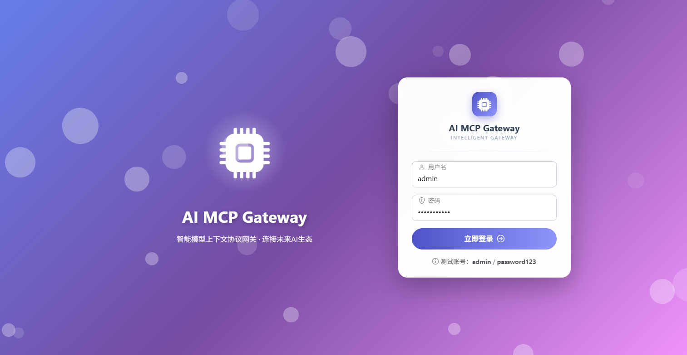
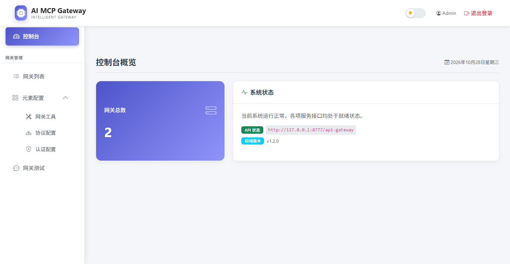
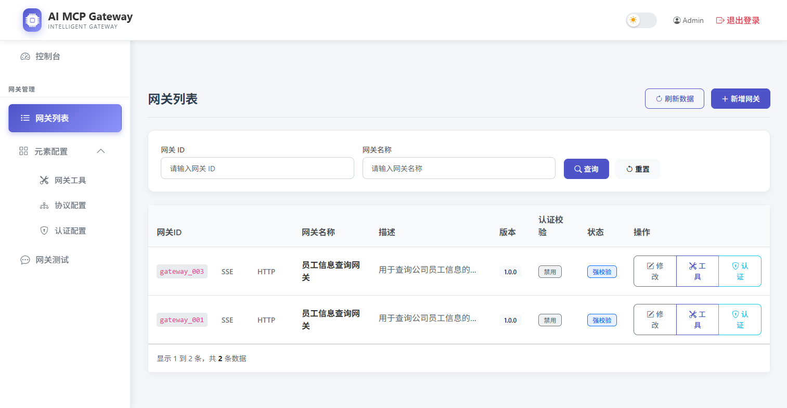
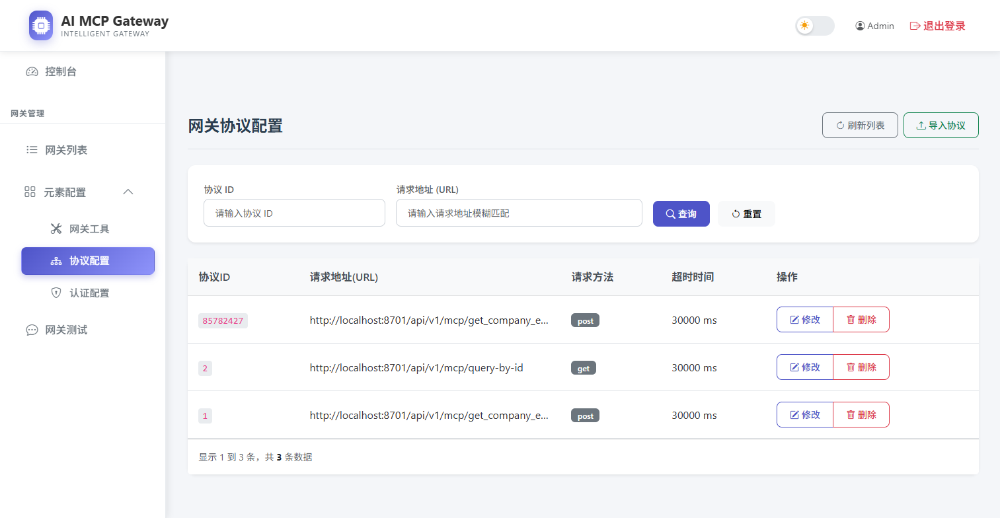
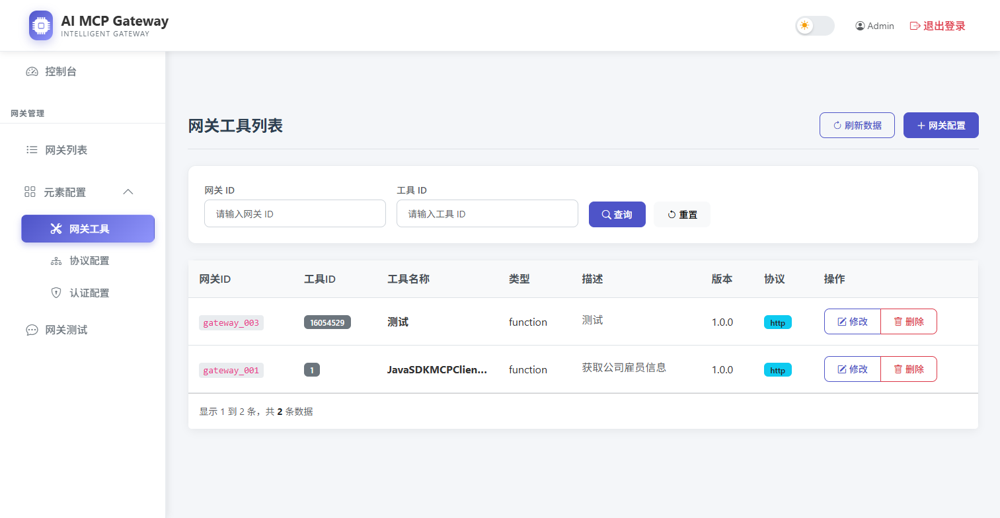
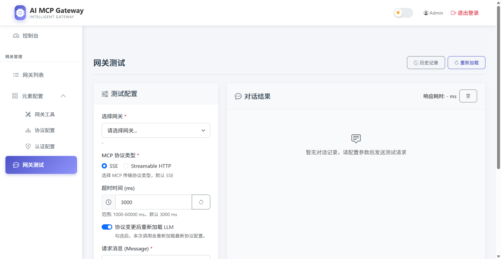

# AI MCP Gateway

> 智能模型上下文协议网关 · 连接未来 AI 生态

## 项目简介

AI MCP Gateway 是一个统一接入与管理 MCP(Model Context Protocol)服务的网关系统,解决各类业务接口便捷转换为 MCP 协议的问题。通过可视化配置,普通 HTTP/RPC 接口无需改造即可快速发布为标准 MCP 服务,供 Claude、Cursor 等 AI Agent 直接调用,大幅降低 AI 应用与业务系统之间的对接成本。

系统对标 Higress AI 网关的通用设计思路,采用 DDD 领域驱动设计的六边形架构,按 MCP 协议 JSON-RPC 2.0 标准构建,内置管理控制台,支持网关配置、协议管理、工具映射、鉴权限流与在线测试的完整闭环。

## 核心特性

- **协议转换** — 按 JSON-RPC 2.0 标准解析与封装 MCP 消息,业务接口零改造接入 AI 生态
- **双传输模式** — 同时支持 SSE 与 Streamable HTTP 两种 MCP 传输协议,适配不同客户端
- **动态配置** — 网关、协议、工具均可在控制台热更新,协议变更后可自动重新加载 LLM 会话上下文
- **鉴权与限流** — 基于 API Key 的网关认证,按网关粒度配置限流速率与过期时间
- **在线测试** — 内置 LLM 对话式测试台,配置完成后即可验证整条调用链路
- **容器化交付** — 全套服务 Docker Compose 一键部署,开箱即用

## 系统架构

项目采用 DDD 领域驱动设计的六边形架构,以领域模型为核心,通过用例层(case)编排领域服务,由触发器层(trigger)对外暴露 HTTP 接口:

```text
ai-mcp-gateway
├── ai-mcp-gateway-app            # 应用启动与配置装配
├── ai-mcp-gateway-api            # 对外 API 定义
├── ai-mcp-gateway-case           # 用例编排层(规则树串联领域服务)
├── ai-mcp-gateway-domain         # 领域模型层
│   ├── session                   # 会话域:会话创建、消息处理、状态管理
│   ├── protocol                  # 协议域:MCP 协议解析与封装(JSON-RPC 2.0)
│   ├── gateway                   # 网关域:网关配置与工具管理
│   ├── auth                      # 鉴权域:API Key 认证
│   └── llm                       # 模型域:LLM 测试网关
├── ai-mcp-gateway-infrastructure # 基础设施层(MySQL / Redis / 网关适配)
├── ai-mcp-gateway-trigger        # 触发器层(HTTP 接口 / 管理端 API)
└── ai-mcp-gateway-types          # 通用类型定义
```

MCP 消息处理采用策略模式,按场景分发到 Initialize(初始化)、Resources(资源)、ToolsList(工具列表)、ToolsCall(工具调用)等处理器,便于扩展新的消息动作;用例层通过规则树组合模式编排领域服务,保持各类场景的迭代与维护成本可控。

## 技术栈

| 分类 | 技术 |
| --- | --- |
| 语言与框架 | JDK 17、SpringBoot 3.x |
| 响应式编程 | Spring WebFlux、Reactor(高并发 SSE 通信) |
| MCP 协议 | JSON-RPC 2.0、Spring AI MCP Server (WebFlux) |
| 数据存储 | MySQL 8.0(配置持久化)、Redis 6.2(会话与鉴权缓存) |
| 远程调用 | Retrofit 2.9、OkHttp 4.9 |
| ORM | MyBatis |
| 部署 | Docker、Docker Compose、Nginx |

## 管理控制台

控制台基于 Vue 前端 + Nginx 部署,与网关核心服务通过管理 API 交互。

### 登录

统一的身份验证入口,保障管理后台访问安全。



### 控制台概览

集中展示网关总数、系统运行状态与版本信息。



### 网关列表

管理网关实例,支持按名称与地址检索。



### 协议配置

维护业务接口到 MCP 协议的映射:录入协议 ID、请求地址与方法、超时时间,支持从外部批量导入协议配置,并一键解析注册。



### 工具配置

将协议接口发布为 MCP Tool,维护工具名称、类型与描述,供 AI Agent 发现与调用。



### 网关测试

内置对话式测试台:选择网关与传输协议(SSE / Streamable HTTP),发送消息即可验证整条 MCP 调用链路,并统计响应耗时;开启「协议变更后重新加载 LLM」后,每次调用会自动加载最新协议配置。



## 快速开始

### 环境准备

- JDK 17+、Docker、Docker Compose
- MySQL 8.0、Redis 6.2(可通过 `docs/dev-ops/docker-compose-environment.yml` 一键拉起)

### 部署步骤

1. 初始化数据库:执行 `docs/dev-ops/mysql/sql/ai_mcp_gateway.sql`
2. 构建应用镜像:`build.sh`(产物 `procket/ai-mcp-gateway-app:1.0`)
3. 启动全套服务:

```bash
docker-compose -p ai-mcp-gateway -f docs/dev-ops/docker-compose-app.yml up -d
```

4. 访问管理控制台:<http://localhost:8600>(默认演示账号 admin / password123)

### 服务端口

| 服务 | 端口 | 说明 |
| --- | --- | --- |
| 管理控制台 | 8600 | Nginx 托管前端页面 |
| 网关服务 | 8777 | MCP 网关核心 + 管理 API |
| 演示 MCP Server | 8701 | 示例业务接口,用于联调测试 |
| Redis Commander | 8081 | Redis 可视化(可选) |

## 相关链接

- [GitHub](https://github.com/Prock-Liy)
- [MCP 协议官网](https://modelcontextprotocol.io/)
